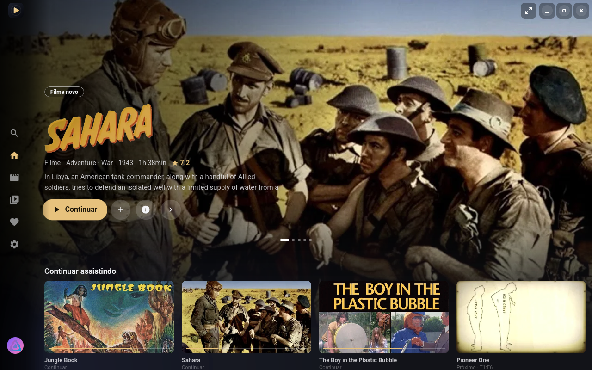
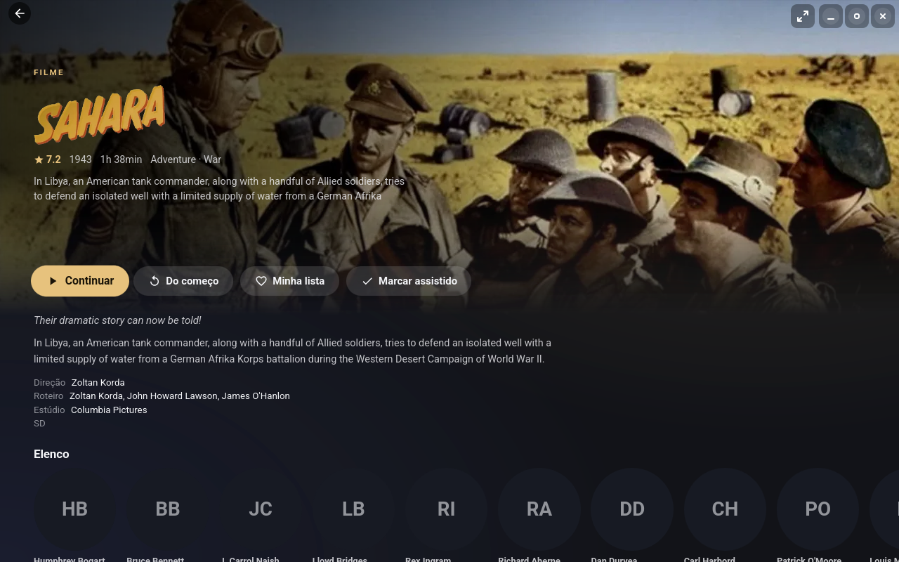
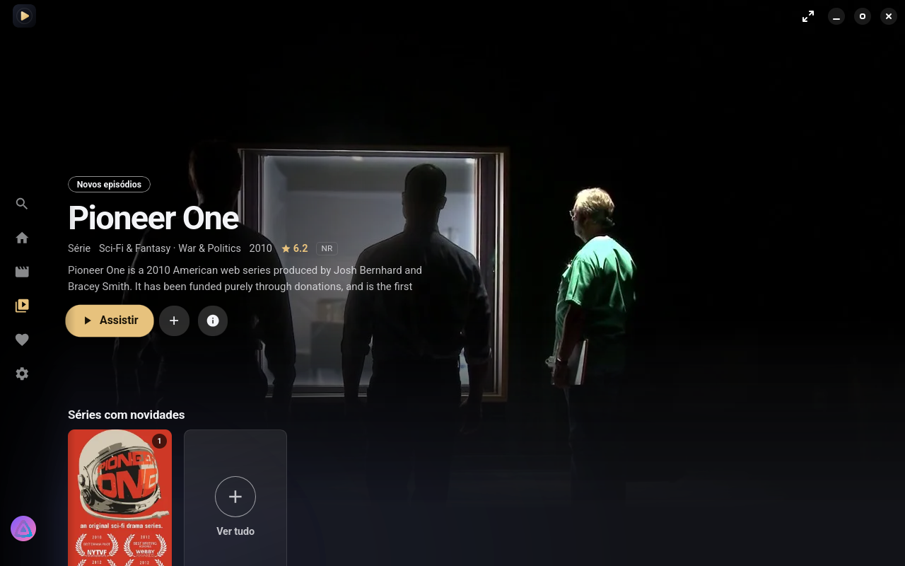
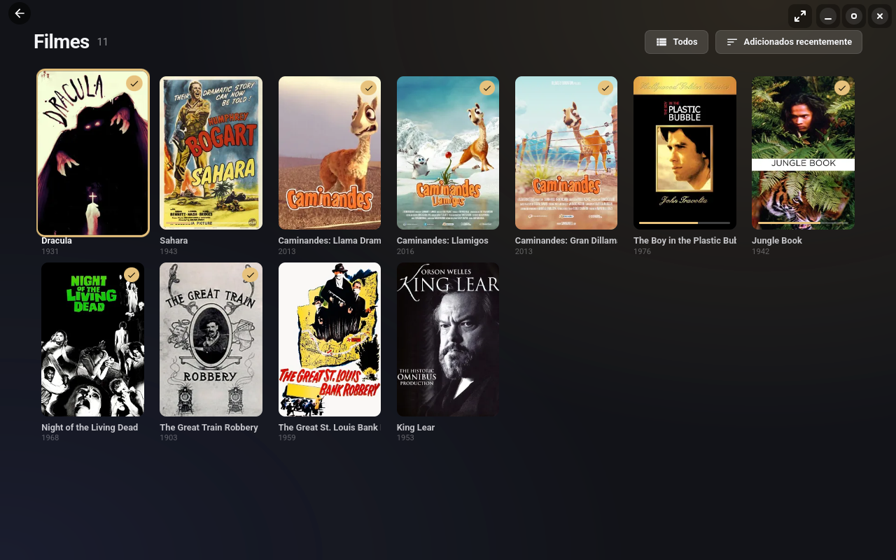
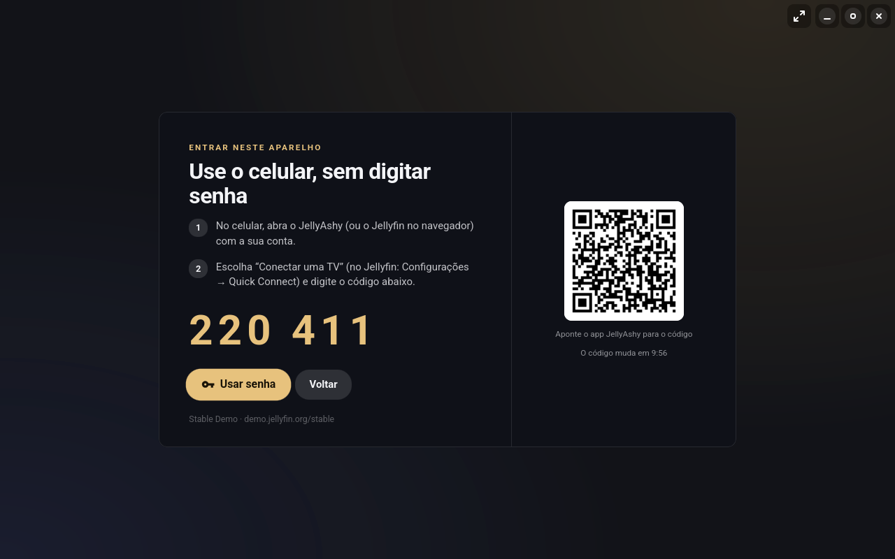

<div align="center">


# JellyAshy for Linux

**Your Jellyfin movies and series on the Linux desktop: a fast, good-looking app, with mpv playing them.**

[🌐 Website](https://jellyashy.talesam.org) ·
[⬇️ Download](https://jellyashy.talesam.org/#baixar) ·
[❤️ Support the project](https://jellyashy.talesam.org/#apoie) ·
[🐞 Report a problem](https://github.com/talesam/jellyashy-desktop/issues)

[](LICENSE)


</div>



JellyAshy is a client for [Jellyfin](https://jellyfin.org), made only for
**movies and series**. It works with any Jellyfin server and is the same app
that runs on Samsung and LG TVs, Android TV, Android phones and the iPhone —
now on the Linux desktop, in a GTK4 window, with **mpv** playing the video.

Because mpv plays almost anything (MKV, HEVC, AV1, 10-bit, DTS, TrueHD…),
the server sends the files **as they are**: no transcoding, no work for a
small server, the best picture and sound the file has.

## Features

- 🎬 **Movies and series** — a home with a featured banner, continue
  watching, next up, recently added, top 10, genres and recommendations.
- 👨‍👩‍👧 **Profiles for the family** — each one with its own progress and
  list, kids profiles with an age limit, optional PIN *(with the
  [JellyAshy server plugin](https://jellyashy.talesam.org/#plugin))*.
- ⏭️ **Skip intro and next episode** — like the streaming services *(intro
  detection by the [Intro Skipper](https://github.com/intro-skipper/intro-skipper)
  plugin on the server)*.
- 🔤 **Subtitles and audio** — the server's subtitles (SRT, ASS, VTT…), audio
  tracks, playback speed, picture modes (fit, fill, zoom).
- 📱 **Sign in with the phone** — scan the QR code or type the code in the
  JellyAshy app (Quick Connect), or use a password.
- ❤️ **My list, search, people** — favourites, search for titles and
  actors, cast pages.
- 🌍 **28 languages**, picked from the system.
- ⌨️🖱️ **Keyboard or mouse** — arrows and Enter like a TV remote, or point
  and click; F11 for full screen.
- 🔒 **Private** — talks only to your Jellyfin server; no accounts, no
  tracking, no ads.

## Screenshots

| | |
|:---:|:---:|
|  |  |
| **Title details** — cast, versions, audio | **Player** — mpv behind JellyAshy's controls |
|  |  |
| **Series** | **The whole library**, filtered and sorted |
|  | |
| **Sign in with the phone** — no password to type | |

<sub>Screenshots taken with Jellyfin's public demo server (public domain and
openly licensed films).</sub>

## Installation

### Arch Linux, BigLinux, Manjaro and other Arch-based systems

```bash
git clone https://github.com/talesam/jellyashy-desktop.git
cd jellyashy-desktop/pkgbuild
makepkg -si
```

Then open **JellyAshy** from the applications menu, or run `jellyashy`.

### Other distributions

Install the dependencies, then run it from the source folder:

| Distribution | Command |
|---|---|
| Debian / Ubuntu / Mint | `sudo apt install python3-gi gir1.2-gtk-4.0 gir1.2-adw-1 gir1.2-webkit-6.0 libmpv2 python3-mpv` |
| Fedora | `sudo dnf install python3-gobject gtk4 libadwaita webkitgtk6.0 mpv-libs python3-mpv` |

```bash
git clone https://github.com/talesam/jellyashy-desktop.git
cd jellyashy-desktop
./run.sh
```

## Getting started

1. Type your server's address — just the name is enough, like
   `jellyfin.example.com` or `192.168.0.10:8096`.
2. Sign in: point the phone at the QR code (or enter the code in the
   JellyAshy app or in Jellyfin → Settings → Quick Connect), or use your
   password.
3. Pick a profile and press play.

## Keyboard and mouse

| Key | Action |
|---|---|
| ← ↑ → ↓ | Move around |
| Enter | Open / play / show the player controls |
| Esc or Backspace | Back |
| F11 | Full screen |
| Ctrl + Q | Quit |
| Mouse | Point to select, click to open, wheel to scroll |

## Settings and data

Everything the app keeps (the servers, the signed-in profiles, the
settings) is in `~/.local/share/jellyashy`; the image cache is in
`~/.cache/jellyashy`. Deleting both folders starts the app afresh.

## How it works

```
┌──────────── GTK4 / libadwaita window ────────────┐
│  WebKitGTK view — JellyAshy's interface          │
│  (transparent while a video plays)               │
│        ▲ commands        │ state, position       │
│        │ (JS bridge)     ▼                       │
│  mpv (libmpv render API in a GtkGLArea) — video  │
└──────────────────────────────────────────────────┘
```

The interface is JellyAshy's web app — the same code the TV and phone apps
run — shown in a WebKitGTK view. The video is drawn by **libmpv** in an
OpenGL area *behind* it: while a video plays, the page turns transparent and
draws only the controls and the subtitles on top. The page drives mpv
through a small bridge (`src/jellyashy_desktop/bridge.py`), the same
interface the Android app offers with ExoPlayer.

## Development

```bash
./run.sh                          # run from the source tree
JELLYASHY_DEVTOOLS=1 ./run.sh     # with the web inspector (right click → Inspect)
python3 -m pytest                 # tests
ruff check src tests tools        # lint
```

The web app is bundled in `src/jellyashy_desktop/web/`. It is built from
the JellyAshy repository; to update it:

```bash
tools/update-web.sh ../JellyAshy  # builds it for Linux and takes its version
```

`JELLYASHY_TEST_PORT=9440 ./run.sh` opens a local test hook (loopback only)
that `tools/drive.py` uses to run scripts in the page, press keys and take
screenshots of the window, video included.

### Project layout

```
src/jellyashy_desktop/
  application.py   the Adw.Application (one window)
  window.py        the window: WebKitGTK view over the video, the bridge's commands
  player.py        mpv in a GtkGLArea and the player commands
  bridge.py        the page ↔ desktop protocol (window.JellyAshyLinux)
  devtools.py      the test hook (off unless JELLYASHY_TEST_PORT is set)
  web/             JellyAshy's web app, built for Linux
usr/               launcher, menu entry, icon, AppStream metadata
pkgbuild/          Arch package
tests/             pytest
tools/             update-web.sh, drive.py
```

## Privacy

JellyAshy talks only to the Jellyfin server you type in. It has no
accounts of its own, collects nothing and shows no ads. See the
[privacy policy](https://jellyashy.talesam.org/privacidade.html).

## Support

JellyAshy is free and has no ads. If it is useful to you, you can support
its development at **[jellyashy.talesam.org/#apoie](https://jellyashy.talesam.org/#apoie)**
(PIX, PayPal or crypto). ❤️

## License

[MIT](LICENSE). Jellyfin is a trademark of the Jellyfin project; JellyAshy
is an independent client.
